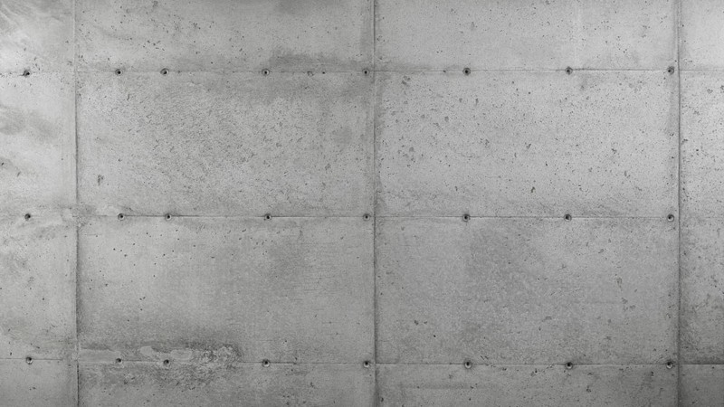
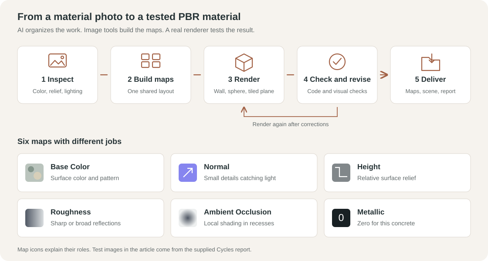
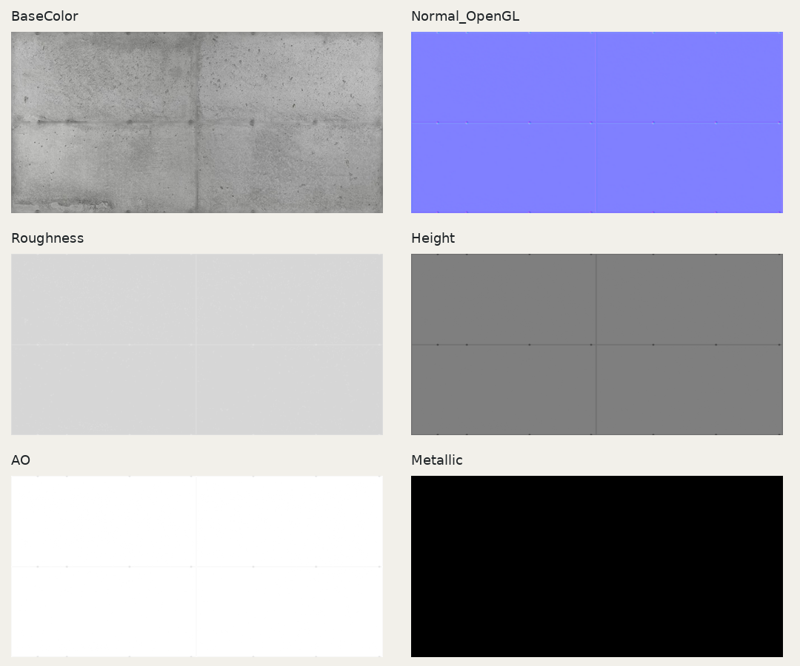
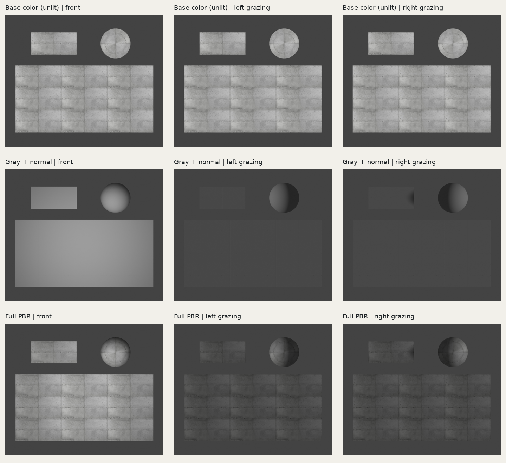

*By Xiaoyu Li*

A photo of a concrete wall can capture exactly the color and pattern we want for a design. Getting that surface into a 3D render takes more work. The renderer also needs to know how the surface catches light, where it has small bumps, and how sharp its reflections should be. In a physically based rendering (PBR) material, texture maps describe these different surface properties.

AI can help connect these steps and make a custom material quicker to try. With a clear task, access to image processing tools, and a real renderer, an AI assistant can help turn a material photo into a set of maps, build a test scene, and revise the result. This concrete example shows how that workflow works and where it still needs judgment.

## Why custom materials take more work

For many designers, a renderer's material library has been the easiest place to start. Its concrete, stone, wood, and paving materials already have maps and settings that work together. Making a new material from a site photo or supplier image means doing that preparation ourselves.

A photo is a useful starting point, but it contains the lighting from the moment it was taken. A dark patch could be a stain, a shadow, or a small hole. If we use the photo directly, those shadows can remain visible even when the lighting changes in our 3D scene.

The difficult maps are usually **roughness** and **normal or height maps**. Roughness controls whether reflections look sharp or spread out. One photo rarely shows enough reflection behavior to tell us the correct value across the surface. Normal and height maps describe surface relief. They require us to separate real grooves and pores from changes in color and lighting. These properties can be ambiguous in a single view. [Research on single image material capture](https://arxiv.org/abs/1810.09718) explains why additional lighting and viewing conditions matter.

For example, making every dark area in a concrete photo lower would turn broad stains into large dents. A usable material needs a more careful reading of the image.

## Which materials are good starting points for AI

For a workflow like this, relatively flat, matte surfaces with readable patterns are practical starting points: concrete, plaster, brick, paving, unpolished stone, and some wood surfaces. A clear photo taken nearly straight on helps, especially when strong shadows and reflections are limited.

Computer vision can use edges, repeated patterns, texture, and shading as clues. Material estimation models can also learn from examples of surfaces rendered under different lights. This gives them a basis for suggesting how color, small surface details, and reflections might fit together. Research such as [Materials for Masses](https://arxiv.org/abs/1804.05790) has demonstrated this approach on nearly flat material samples photographed with a flash. Clear patterns and simpler reflections make these surfaces useful candidates for trying a similar workflow.

Glossy metal, glass, translucent surfaces, and wet materials need more care. Their appearance depends strongly on the light and viewing angle. A reflection in a photo may show the surrounding scene rather than a pattern on the material itself.

An AI assistant can also help without running a specialized vision model. It can write image processing code, organize the map files, set up a renderer, and check the outputs. That was the approach in this concrete test: Python processed the images and calculated the maps, while Blender 4.0.2 rendered the tests with Cycles. No dedicated material estimation model or generative image model was used.

## A concrete workflow from photo to tested material

The starting reference was an 800 by 450 pixel image of exposed concrete. It showed formwork joints, rows of circular holes, small pores, and broad patches of uneven color.

Figure 1. The source image. This is the material reference, not a render test.

The prompt asked the assistant to complete the whole process: inspect the image, create aligned maps, build a 3D scene, render it, correct problems, and package the results. It also gave a key instruction: keep the joints and holes as relief, and treat the broad mottling mainly as color variation.

Figure 2. The workflow and the role of each map. All maps share one image layout.

### 1 Inspect the image and choose one shared crop

First, check the image resolution, perspective, uneven lighting, shadows, and edges. Then decide which features belong to the material's color and which represent actual surface relief.

In this case, the chosen crop was 664 by 324 pixels and contained about two formwork repeats in each direction. The same crop was used for every map. It was kept at its original resolution, so the process added no AI generated detail. The joints and holes were adjusted approximately into a repeating layout.

### 2 Build the maps together

Each map has a different job, but the joints and holes must stay in the same places throughout the set.

<table>
<thead><tr><th scope="col">Map</th><th scope="col">What it controls</th><th scope="col">What happened in this example</th></tr></thead>
<tbody>
<tr><td>🎨 Base Color</td><td>Surface color</td><td>Reduced broad lighting variation while preserving the concrete's mottling.</td></tr>
<tr><td>↗ Normal</td><td>How small details catch light</td><td>Calculated from the same height field used for the joints, holes, and small pores.</td></tr>
<tr><td>↕ Height</td><td>Relative surface relief</td><td>Kept the main wall flat and represented joints and holes as recesses.</td></tr>
<tr><td>◐ Roughness</td><td>How sharp reflections appear</td><td>Started near 0.84, with small variations around surface features. These values were assumptions.</td></tr>
<tr><td>◒ Ambient Occlusion</td><td>Approximate local shading in recesses</td><td>Estimated from the height field and used lightly in the material.</td></tr>
<tr><td>● Metallic</td><td>Whether the surface behaves as metal</td><td>Set to zero for concrete.</td></tr>
</tbody>
</table>

Figure 3. The map set. The broad color patches stay mainly in Base Color; the relief maps focus on joints, holes, and small surface details.

The important instruction here is to keep the maps consistent. If a hole moves between the color and normal maps, the rendered surface will look wrong. Deriving Normal from the shared Height field helps maintain that relationship.

Roughness also needs its own reasoning. Simply converting the color photo to grayscale would make darker concrete patches behave differently in reflections without evidence that they should.

### 3 Test the material in a real renderer

The test scene contained a wall, a sphere, and a plane with the material repeated three by three. The wall showed the pattern clearly, the sphere helped reveal reflection behavior, and the repeated plane exposed edge problems.

Base Color was read as sRGB. Normal, Roughness, Height, and Ambient Occlusion were read as Non-Color data. The normal map used the OpenGL convention. The full material used Normal for surface detail, while Height was tested separately through a bump node to avoid applying the same relief twice.

Three lighting setups were used: soft front light, light grazing from the left, and light grazing from the right. Each was rendered with color only, fixed gray color plus Normal, and the full material. The gray version helped reveal whether color patches had accidentally become bumps.

Figure 4. Actual Cycles tests from the supplied report. Columns show front, left, and right lighting; rows show color only, gray with Normal, and the full material. The color only row uses an unlit shader, so it stays unchanged when the light moves.

### 4 Check the results and revise

Code checked image sizes, channels, value ranges, normal vector lengths, and opposite image edges. Visual checks then examined the recesses, reflection behavior, and repeated pattern under changing light.

The process went through three rounds. Early lighting was too bright, and the holes and joints looked too deep. Later rounds reduced their assumed depths and recalculated Height, Normal, and Ambient Occlusion together. The final side lighting used parallel lights to give the large test plane more even illumination.

The final report found no obvious extra seams in the repeated plane, although the repeated color pattern was still recognizable. Matching edge pixels helped, but the tiled render was needed to judge the visible result.

### 5 Keep the assumptions with the material

The report described a delivery package containing the independent maps, overview images, test renders, a Blender scene, scripts, and a short report. Keeping those files together makes the material easier to inspect and adjust later.

The demonstration assumed a tile about 3.315 by 1.615 meters, circular recesses about 4 millimeters deep, and joints about 1.5 millimeters deep. Those dimensions were not measured from the real wall. Roughness was also an estimate. The tests checked whether the maps worked together and rendered consistently; they did not establish the real material's physical properties.

At 664 by 324 pixels, this result is more suitable for medium and distant views. Close views expose the limited detail, simplified holes, and softened edges. A close view of the material would benefit from a better source image or additional capture data.

AI makes this workflow easier to organize and repeat. A useful prompt gives it concrete outputs, rules for interpreting the photo, and checks to run in a real scene. That lets designers try a material from their own reference image and judge whether it is ready for the view they need.

## Example prompt to create a material set

Upload your material image, then use the prompt below with an AI assistant that can create files, run code, and use a 3D renderer. Add any known dimensions and notes about the surface, such as which marks are stains and which are actual recesses.

<pre class="prompt-template">
Turn the uploaded material image into a PBR material set for 3D rendering. Complete the work, including file creation and real render tests.

1. Inspect the image.
Identify the material, resolution, perspective, lighting, shadows, highlights, and tiling conditions. Separate color variation from actual surface relief and lighting effects. Do not treat every dark patch as a dent. List any assumptions about scale, depth, and physical properties.

2. Create aligned maps.
Export BaseColor.png, Normal_OpenGL.png, Roughness.png, Height.png, and AO.png. Use the same dimensions, crop, orientation, and feature positions in every map. Set Metallic appropriately for the material; for concrete, use 0. Export Metallic.png if needed.

Reduce directional shadows and highlights in Base Color while keeping the material's color pattern. In Height, use white for high areas and black for low areas, and state the flat surface value. Keep Normal consistent with Height and state its coordinate convention. Estimate Roughness conservatively rather than copying grayscale Base Color. Estimate AO from surface structure rather than copying dark areas in the photo.

Make the set repeatable where possible, applying edge corrections consistently across all maps. Match the resolution to the source information. Explain any upscaling or invented detail, and record the tools and methods actually used.

3. Build and render a test scene.
Use Blender or another available real 3D renderer. Create a wall, a sphere, and a plane with 3 by 3 texture repeats. Read Base Color as sRGB and the other maps as Non-Color data. State the texture scale, relief strength, and material settings. Avoid applying the same relief twice through Normal and Height.

Render soft front light, left grazing light, and right grazing light. Include color only, fixed gray with surface detail, and full PBR versions. Use neutral lighting and fixed color management. Do not use AI generated illustrations as render test evidence.

4. Check and revise.
Check map alignment, recess direction, reflection behavior, texture scale, and tiled edges. Use code to check image dimensions, channels, ranges, normal vector lengths, and edge differences. Also inspect the tiled renders visually. Correct problems and render again, for up to three rounds. Record unresolved issues.

5. Deliver the files.
Provide the independent maps, map overview, actual test renders, reusable scene and scripts, a short report, and a ZIP. Distinguish program checks, visual checks, and unverified physical properties. State whether the result suits close, medium, or distant views. If no real renderer can run, clearly state that 3D render validation is incomplete and deliver the completed work with runnable scripts.
</pre>
