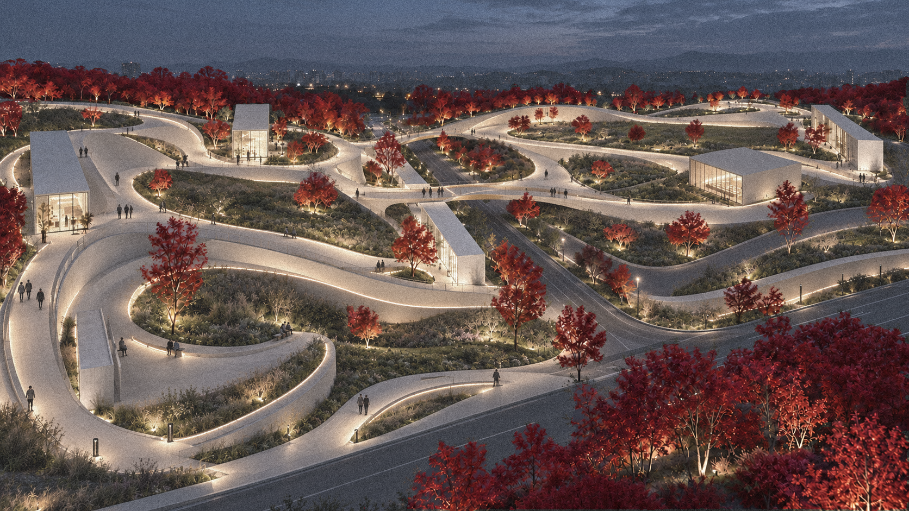
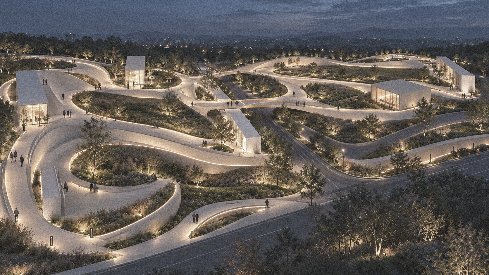
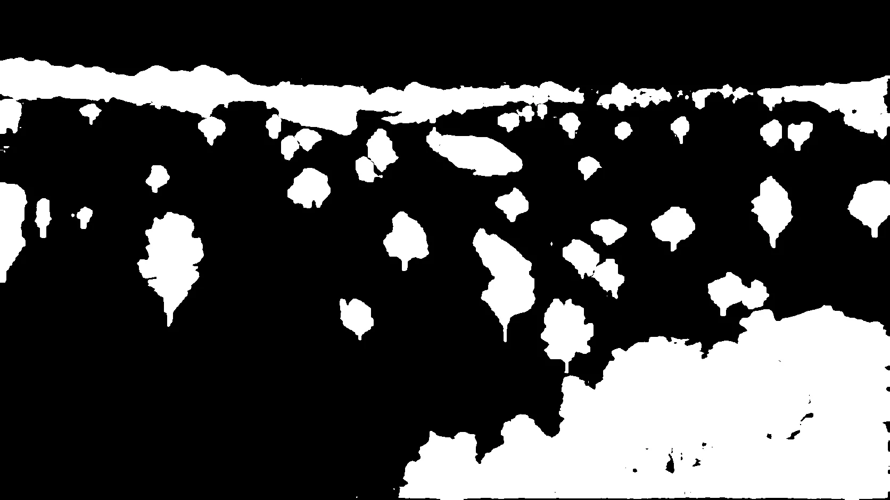
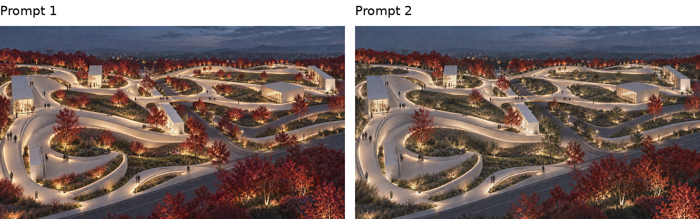
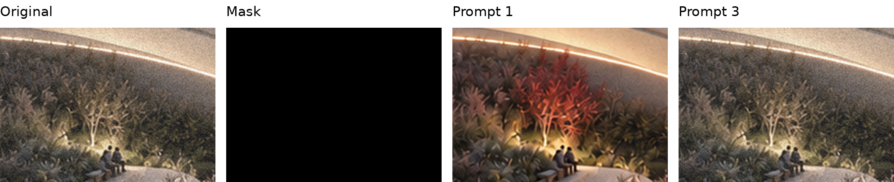
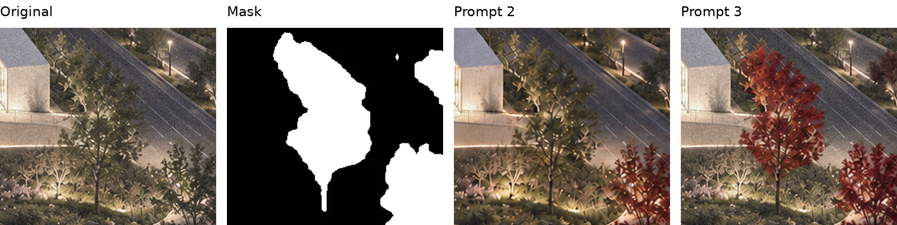

*By Xiaoyu Li*

I tested a simple way to make AI image editing more controllable: let AI create the visual change, use a selection mask to decide where that change can appear, and check the saved image with code. The task was to turn selected trees into crimson autumn foliage while preserving an existing landscape rendering. Three prompt versions produced visibly different results. The third workflow recolored the selected tree groups and preserved every pixel outside the mask.

Figure 1. The final result from Prompt 3. The autumn treatment is confined to the selection mask. <a href="../../downloads/controlled-ai-editing/final-result.png">Full-size PNG</a>.

The images displayed on this page are optimized web previews. The pixel checks below apply to the unmodified PNG files available through the full-size links, not to the compressed previews.

## A small edit with a clear design purpose

In a landscape presentation, a seasonal planting variation should be easy to compare with the original scheme. The paths, pavilions, people, and lighting provide a stable setting for that comparison. If AI changes additional planting or alters the surrounding image, viewers are no longer comparing the same proposal. This case shows how a designer can specify a local visual change and check whether the boundary was actually respected.

## The original image and selection mask

The original rendering and mask share the same 1672 by 941 pixel frame. White selects the trees to edit; black protects the rest of the scene. The mask adds a visible boundary to the verbal request.

Figure 2. The original rendering establishes the composition, tree locations, texture, and dusk lighting. <a href="../../downloads/controlled-ai-editing/original-rendering.png">Full-size PNG</a>.

Figure 3. The aligned selection mask. Its white regions define where edits are permitted. <a href="../../downloads/controlled-ai-editing/selection-mask.png">Full-size PNG</a>.

Within the white regions, only visible leaves should change. Trunks and background gaps still need protection.

## How the first two prompts behaved

Figure 4. Prompt 1 changes more trees than requested. Prompt 2 limits the edit more closely but leaves some selected canopies unchanged. <a href="../../downloads/controlled-ai-editing/prompt-comparison.png">Full-size PNG</a>.

### Prompt 1 used the mask to identify trees

The first prompt said, "Use Image 2 only to locate the selected trees." It also restricted changes to leaves inside white regions and protected black areas. Even with those instructions, some unselected trees turned red. The model still had to interpret the selection and its boundaries during generation.

Figure 5. This crop is entirely black in the mask. Prompt 1 recolors its tree; Prompt 3 preserves the original. Crops use the same location in each image. <a href="../../downloads/controlled-ai-editing/protected-tree-comparison.png">Full-size PNG</a>.

### Prompt 2 stated a stricter boundary

The second prompt stated, "The mask is an edit boundary, not a reference for identifying whole trees." It explicitly protected black areas and left uncertain pixels unchanged. Some selected foliage was still missed, including the central canopy below. Stronger wording did not produce complete coverage in this run.

Figure 6. A selected central canopy is missed by Prompt 2 and recolored by Prompt 3. White in the mask marks the editable part of this crop. <a href="../../downloads/controlled-ai-editing/selected-canopy-comparison.png">Full-size PNG</a>.

## What made the third workflow work

Prompt 3 required generation, compositing, and verification before delivery. The generated image became an intermediate result, and code enforced the selection boundary.

<table>
<thead><tr><th scope="col">Version</th><th scope="col">How the mask was used</th><th scope="col">Result in this case</th></tr></thead>
<tbody>
<tr><td>Prompt 1</td><td>A reference for identifying the selected trees</td><td>Additional unselected trees turned red</td></tr>
<tr><td>Prompt 2</td><td>An explicit boundary described in words</td><td>Some selected foliage remained unchanged</td></tr>
<tr><td>Prompt 3</td><td>A binary selection applied by code</td><td>Selected tree groups recolored and protected pixels preserved</td></tr>
</tbody>
</table>

### Generate the foliage edit

AI produced crimson foliage while retaining the scene and dusk lighting. Before compositing, I inspected the candidate and confirmed that its framing matched the original.

### Copy pixels through the mask

Python treated mask values of 128 or higher as editable. It copied generated pixels into that selection and original pixels everywhere else. It did not blur, expand, or feather the mask. This restored the protected areas even where the generated candidate had changed them.

### Reopen and verify the saved image

The saved lossless PNG was reopened and compared with the original. A fresh check of red, green, blue, and transparency values in the final image confirmed the result below.

<table>
<thead><tr><th scope="col">Check</th><th scope="col">Verified result</th></tr></thead>
<tbody>
<tr><td>Output dimensions</td><td>1672 by 941 pixels</td></tr>
<tr><td>Changed pixels outside the mask</td><td>0</td></tr>
<tr><td>Changed pixels inside the mask</td><td>425,485</td></tr>
</tbody>
</table>

These counts were reproduced by comparing the decoded RGBA pixel values of the three PNG files supplied with this article. [Download the verification report](../../downloads/controlled-ai-editing/pixel-verification.json).

Zero confirms preservation outside the mask. Leaf color, trunks, and canopy gaps inside white areas still need visual review. The inside count includes any pixel change; it is not a count of red leaves.

## Using the method in design practice

The method can help compare planting palettes or paving finishes while preserving context. Match the mask to the task: select leaves separately from trunks, or include the expected shadow area when adding a shade tree. AI supplies a visual candidate; the landscape architect controls the selection and judges the result. Plant suitability and shade performance need separate assessment.

## Complete prompt template

Attach the original rendering as Image 1 and the aligned selection mask as Image 2. Use the complete text below in an environment with an image editing tool and code execution.

<pre class="prompt-template"><code>Edit the uploaded landscape image using a three-stage workflow: image generation, programmatic mask compositing, and pixel verification. Complete all three stages before delivering the final result.

INPUTS

- Image 1: the original landscape rendering.
- Image 2: the aligned black-and-white selection mask.
- White means editing is permitted; black means the original pixels must be preserved.

STAGE 1 - GENERATE THE EDIT

Use the image-editing tool to change visible tree foliage within the white mask regions to natural crimson-red autumn foliage, with subtle scarlet and burgundy variation.

Preserve tree positions, canopy silhouettes, foliage density, branch structure, trunks, and background visible through foliage gaps. Retain the original dusk lighting, shadows, exposure, texture, and atmospheric depth. Avoid a global color grade.

Use the original composition and framing. Treat the generated image as an intermediate result, not the final deliverable.

STAGE 2 - COMPOSITE USING CODE

Actually execute Python or an equivalent image-processing program. Do not substitute visual inspection or another generative edit for this step.

1. Load the original image, mask, and generated result.
2. Confirm that the original and mask have identical pixel dimensions and alignment. Do not resize or modify either.
3. If the generated result has different dimensions but identical framing and aspect ratio, resize only the generated result to the original dimensions. If framing or spatial alignment differs, regenerate before compositing.
4. Convert the mask to grayscale and create a binary selection: values &gt;=128 are editable; values &lt;128 are protected.
5. Create the final image by copying generated pixels into editable locations and original pixels into every protected location.
6. Do not dilate, blur, feather, or otherwise expand the selection.

STAGE 3 - VERIFY THE SAVED OUTPUT

Save the composite as a lossless PNG, reopen it, and compare its decoded pixel values against the original using code.

Count protected pixels where any color channel differs. The required count is exactly 0.

If the count is greater than 0, repair the compositing or saving process and repeat verification. Do not deliver a result that fails this check.

DELIVER

Provide the final composited PNG and a brief verification report containing:
- Output dimensions.
- Number of changed pixels outside the mask: 0.
- Number of changed pixels inside the mask.

This verification establishes preservation outside the mask; also visually inspect the edited foliage for natural color and consistency.

If image generation or code execution is unavailable, explain which stage could not be completed. Do not claim pixel verification without actually executing it.</code></pre>

*Images supplied by Xiaoyu Li. Comparison panels and close-ups use the uploaded images without generative alteration.*
