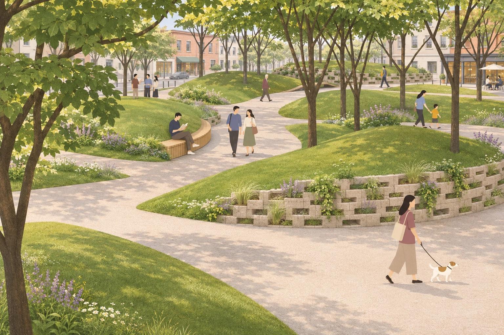
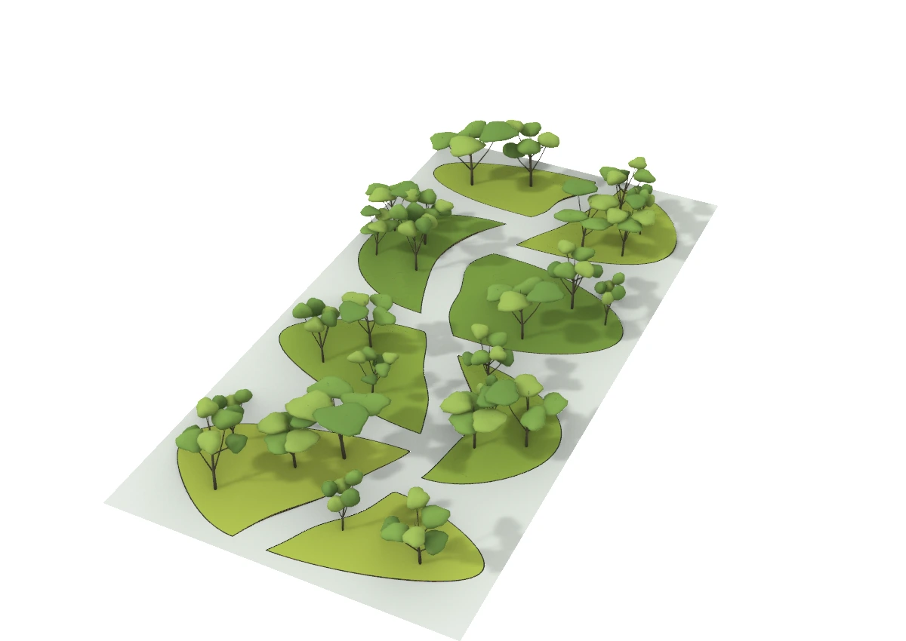
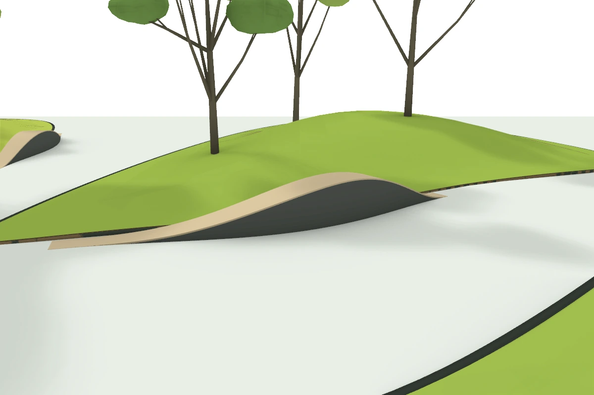
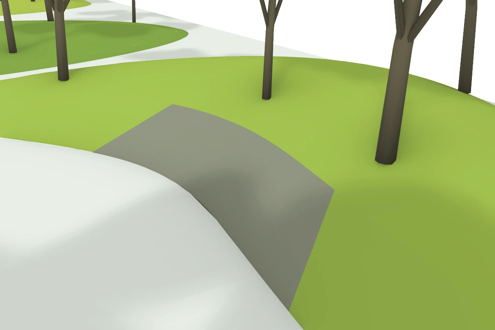
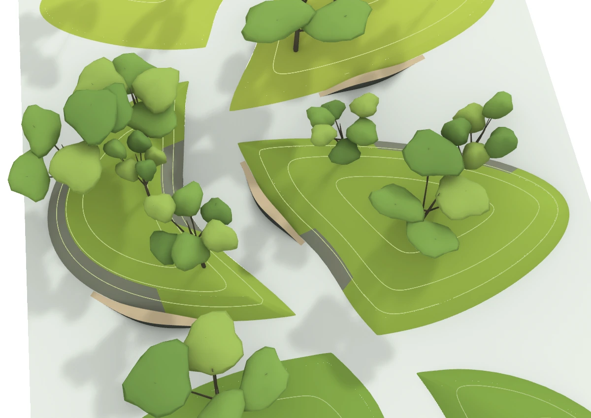

A visual brief became a 40 × 80 m Rhino garden with flowing paths, raised planting islands, and groups of trees. Follow-up instructions added undulating edge seating and rebuilt the terrain as smooth NURBS surfaces. Four Codex turns totaled 59 minutes 58 seconds of active runtime, producing geometry that remains editable.

Figure 1. AI rendering produced separately by the author after modeling. Planting detail, masonry texture, people, and the urban setting extend the visual presentation. Dimensions and object counts come from the Rhino model records. <a href="/downloads/rhino-mcp-landscape-workflow/final-ai-render.webp" target="_blank" rel="noopener">Open full-size image</a>.

## A garden built through specific design decisions

The aim was a sculptural garden with fluid circulation, asymmetrical landforms, and open views beneath trees. The designer supplied the reference image, dimensions, and revision goals. Codex wrote and revised scripts; a Rhino MCP connection executed operations in the active Rhino session.

The final model contains 8 planting islands, 26 trees, 5 edge seats, and 8 inclined wall segments. Saved scripts, parameters, object IDs, and checks make the changes possible to inspect and continue.

## Recorded runtime and what it includes

The table records four completed Codex turns from this case. A full turn includes task interpretation, script writing, debugging, screenshot review, and export. Durations are rounded to the nearest second.

<table>
<thead><tr><th scope="col">Task</th><th scope="col">Codex runtime</th><th scope="col">MCP total sec</th><th scope="col">Calls</th></tr></thead>
<tbody>
<tr><td>Inspect the Rhino environment</td><td>19 sec</td><td>0.22</td><td>3</td></tr>
<tr><td>Build the initial garden</td><td>17 min 07 sec</td><td>13.23</td><td>46</td></tr>
<tr><td>Add undulating edge seating</td><td>12 min 01 sec</td><td>13.67</td><td>28</td></tr>
<tr><td>Vary and rebuild the terrain</td><td>30 min 31 sec</td><td>91.36</td><td>40</td></tr>
<tr><td>Total</td><td>59 min 58 sec</td><td>118.47</td><td>117</td></tr>
</tbody>
</table>

The MCP total adds the recorded duration of queries, script execution, captures, saves, and retries. It is not pure geometry computation time. The 59 min 58 sec total adds active turns and excludes gaps between them, the later AI rendering, and article preparation. No manual modeling benchmark was recorded.

### How Codex and Rhino MCP worked together

MCP means Model Context Protocol. It lets AI applications use tools provided by other systems. [1](https://learn.chatgpt.com/docs/extend/mcp?surface=cli) [2](https://modelcontextprotocol.io/docs/2026-07-28/learn/architecture) The connection used here exposed environment queries, Python execution, viewport captures, and model saving. Available tools depend on the connected server.

Codex created geometry through Python and RhinoCommon; this case did not build a Grasshopper definition. Rhino returned geometry, check results, and screenshots that informed the next revision.

## Step 1 Inspect the Rhino environment

**Codex runtime 19 sec    Rhino MCP 0.22 sec across 3 calls**

**Brief for this step**

<pre class="prompt-template">Read the current Rhino working environment.</pre>

The first turn checked the connected session, document, units, layers, selection, and views. Rhino 8.36 was open with an empty document, millimeter units, and an absolute tolerance of 0.01 mm.

That established the scale for later work: a 40 × 80 m site needed a footprint of about 40000 × 80000 mm in the active document.

## Step 2 Build the garden from a visual brief

**Codex runtime 17 min 07 sec    Rhino MCP 13.23 sec across 46 calls**

**Brief for this step**

<pre class="prompt-template">Use the reference image to guide spatial organization and flowing curves. Build a 40 × 80 m garden, checking the plan before adding terrain, paving, trees, materials, and views. Keep Rhino geometry editable and retain layers, IDs, and scripts.</pre>

The reference became a set of modeling rules: a continuous winding route, islands of different proportions with tapered ends, and off-center terrain peaks. Trees were grouped with open areas between them. Plan checks came first so that an island could not block the main route.

Figure 2. Rhino overview of the first model. Terrain was mesh geometry at this stage; paving used Brep surfaces (boundary representation), and trees were reusable block instances. <a href="/downloads/rhino-mcp-landscape-workflow/rhino-initial-model.webp" target="_blank" rel="noopener">Open full-size image</a>.

The plan produced 8 nonintersecting islands and a minimum main-route clearance of about 2.93 m. Initial terrain peaks ranged from 0.48 to 1.50 m. Pale gray paving connected around the islands, with solid dark edging at higher boundaries.

The 26 trees used 4 block prototypes with trunks, major branches, and simplified crowns. Heights ranged from 6.18 to 9.58 m. Ray checks placed tree bases on the groundcover surface, which used a limited range of greens.

Parameters were saved with a fixed random seed of 240611. Islands were numbered I01 to I08, and each tree retained its island assignment. Objects were organized under GardenDemo. Plan, terrain, planting, materials, and view work all belong to this recorded turn.

## Step 3 Add undulating edge seating

**Codex runtime 12 min 01 sec    Rhino MCP 13.67 sec across 28 calls**

**Brief for this step**

<pre class="prompt-template">Place seats along selected path and terrain edges. Both ends should meet path level, with a peak of about 60 to 80 cm between them. Allow different rising and falling curves for a natural, asymmetrical profile.</pre>

Codex read the existing island boundaries and selected wider path edges for seating. Each seat had separate controls for height, peak position, and the rise and fall on either side. This produced varied profiles along the garden edge.

Figure 3. The S02 seat rises and falls along the island edge. Its peak is offset from the length midpoint. The seat top and supporting body are separate closed NURBS Brep solids. <a href="/downloads/rhino-mcp-landscape-workflow/rhino-edge-seating.webp" target="_blank" rel="noopener">Open full-size image</a>.

Five seats were added, about 7–9 m long, with maximum widths of 0.76–0.86 m. Peak heights were 68, 78, 72, 76, and 64 cm. Both ends returned to path level. These are sculptural edge forms whose seating details can be developed further.

Paving was cut out beneath the seats to resolve overlapping surfaces at their tapered ends. A continuous main passage of at least 2.8 m remained; the smallest remaining clearance on the outer side routes was about 2.69 m.

Seat tops, supports, and guides were separated under GardenDemo::Seating. All 10 solid components were valid and closed. Terrain and tree geometry were preserved during this turn.

## Step 4 Vary the terrain and rebuild it as NURBS

**Codex runtime 30 min 31 sec    Rhino MCP 91.36 sec across 40 calls**

**Brief for this step**

<pre class="prompt-template">Vary the heights of the planting islands. Where smaller, taller islands have steep edges, add inclined retaining walls that follow the slope and lean inward. Rebuild the terrain as smooth, editable NURBS surfaces.</pre>

This turn changed both height and geometry type. New peaks ranged from 0.55 to 2.10 m: some islands rose while others became lower. Existing plan boundaries, paths, and seating positions were retained.

Figure 4. An inclined wall at I06 rises inward from the path toward the planting island. Its curved alignment and changing height connect it to the landform. <a href="/downloads/rhino-mcp-landscape-workflow/rhino-inclined-wall.webp" target="_blank" rel="noopener">Open full-size image</a>.

Each main landform became a bicubic NURBS surface with a 19 × 27 control net. NURBS uses control points, degrees, and knots to define editable curves and surfaces. [3](https://developer.rhino3d.com/en/guides/general/essential-mathematics/parametric-curves-surfaces/) Main surfaces were internally C2 continuous, with continuous second derivatives; toe transitions and walls were separate geometry.

Eight solid inclined wall segments were created at steeper edges of I02, I04, and I06. Wall angles were about 27.74°–37.03° from horizontal. The 28° trigger was a modeling threshold; no soil parameters were supplied to establish an engineering angle of repose.

Trimming, closed outlines, and transition matching required several trials. The last successful build call took about 20.31 sec; the full turn took 30 min 31 sec. These measure different parts of the work.

## Check the changes against the geometry

After changing elevations, Codex placed all 26 tree bases on the new surfaces, preserving their plan positions, prototypes, and scales. The peak-height comparison makes the requested variation explicit.

<table>
<thead><tr><th scope="col">Island ID</th><th scope="col">Initial peak m</th><th scope="col">Revised peak m</th></tr></thead>
<tbody>
<tr><td>I01</td><td>0.75</td><td>1.05</td></tr>
<tr><td>I02</td><td>1.12</td><td>1.75</td></tr>
<tr><td>I03</td><td>1.50</td><td>1.25</td></tr>
<tr><td>I04</td><td>0.62</td><td>2.10</td></tr>
<tr><td>I05</td><td>0.48</td><td>0.55</td></tr>
<tr><td>I06</td><td>1.35</td><td>1.95</td></tr>
<tr><td>I07</td><td>0.90</td><td>0.85</td></tr>
<tr><td>I08</td><td>1.18</td><td>1.50</td></tr>
</tbody>
</table>

Figure 5. A Rhino check view with 24 NURBS contours at 0.5 m intervals. Their layer can be toggled, and each curve remains separately editable. <a href="/downloads/rhino-mcp-landscape-workflow/rhino-nurbs-contours.webp" target="_blank" rel="noopener">Open full-size image</a>.

A separate check confirmed 8 cubic NURBS main surfaces, 8 closed wall segments, 8 closed soil reference volumes, and 24 NURBS contour curves. The active terrain no longer contained mesh objects.

Geometry checksum comparisons confirmed that 36 paving, boundary, seating, and guide objects were unchanged. Tree-base ray checks had a model-internal error below 0.01 mm. Earlier terrain meshes were retained on hidden backup layers for comparison.

## Use the model to guide the next design decision

### What the AI rendering adds

The author produced the opening image separately with AI after Rhino modeling. It adds planting layers, material detail, people, and a street setting. This rendering time is excluded from the recorded Codex runtime.

Flower borders, individual masonry blocks, and surrounding buildings in the image do not all come from modeled Rhino geometry. Use the model and its checks when discussing dimensions or construction; use the image to discuss the garden experience.

### Write requirements that can be checked

The useful instructions connected design intent to object relationships: keep the main route continuous, return seat ends to path level, and place trunks on actual terrain. Natural variation was expressed through curved outlines, offset peaks, and grouped planting.

For another project, replace the dimensions and parameters in the structure below. Advance one defined set of changes per turn, save the previous version, and inspect the geometry before continuing.

**A reusable task structure**

<pre class="prompt-template">Read the active Rhino document and confirm units, objects, and layers.
Build a continuous main route and planting islands, then check plan clearances.
Create editable paving and terrain; centralize widths, heights, tree count, and random seed.
Use tree block instances and place their bases on the actual terrain.
For revisions, read existing boundaries and IDs, preserving paths and seats that should carry forward.
Check boundaries, validity, relationships, and screenshots. Save a new model version and its script.</pre>

### Keep room for design development

The approximately 60 minutes includes debugging and checks across four active turns. The 117 Rhino MCP calls totaled about 118 seconds. Interface execution time and a complete design iteration measure different work; this case does not establish a speedup over manual modeling.

Trees remain concept-level prototypes. Paving joints, seat details, drainage, and wall construction need further development. Internal C2 continuity of a terrain surface does not establish matching curvature across every separate adjoining component.

The reusable results are the model, parameter scripts, layers, island and tree IDs, and check records. Together, they let the next revision build on the existing design with a record of what changed.

### Technical references

<a href="https://learn.chatgpt.com/docs/extend/mcp?surface=cli">[1] OpenAI Model Context Protocol</a>

<a href="https://modelcontextprotocol.io/docs/2026-07-28/learn/architecture">[2] MCP Architecture overview</a>

<a href="https://developer.rhino3d.com/en/guides/general/essential-mathematics/parametric-curves-surfaces/">[3] McNeel Parametric Curves and Surfaces</a>

## Case study download and records

[Download the complete case study in Word](/downloads/rhino-mcp-landscape-workflow/AI4LA-Rhino-MCP-Case-Study.docx).

Runtime data comes from the four completed Codex turns and the recorded Rhino MCP calls. The full-turn durations totaled 3,597,757 ms; 117 MCP calls totaled 118,472 ms. Totals were calculated before rounding. Separate durations are not assigned to the internal plan, terrain, planting, and view phases. Step briefs are English summaries of the original Chinese instructions.

Model counts and dimensions come from the garden, seating, and NURBS manifests and the saved scripts `garden_demo.py`, `edge_seating.py`, and `terrain_nurbs.py`. The final AI rendering was produced separately and is not used as geometry evidence.
