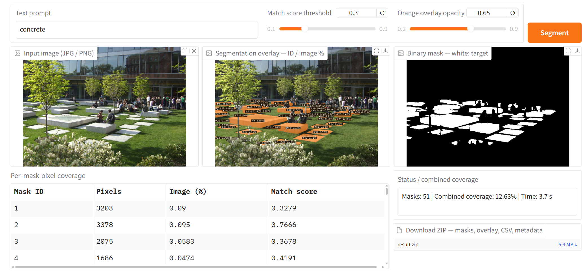
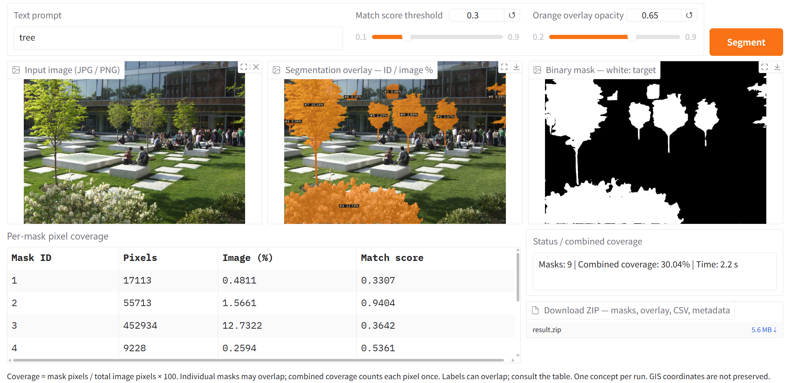
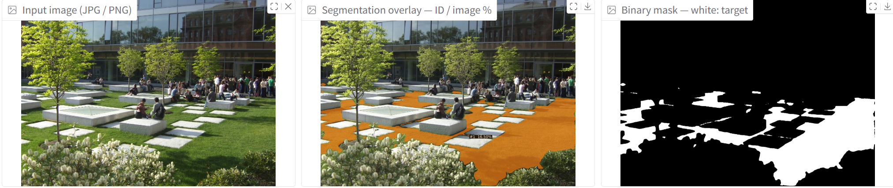
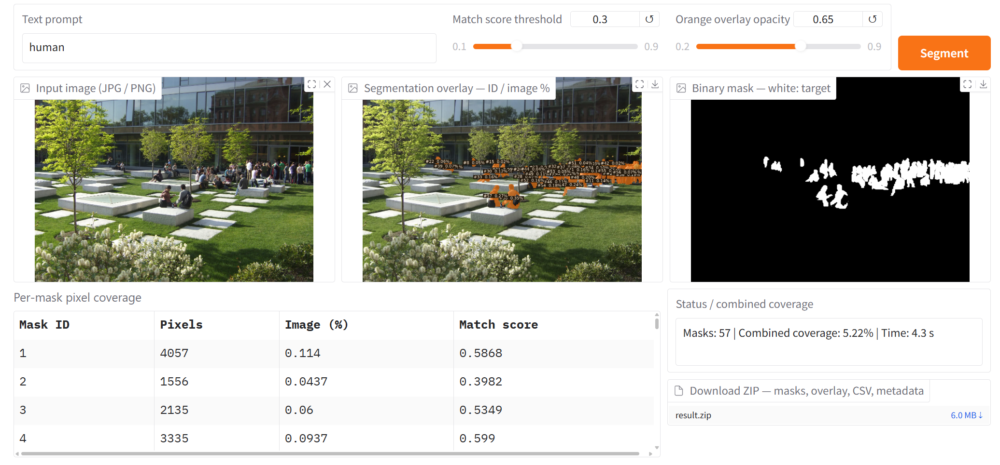
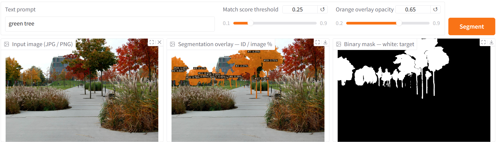
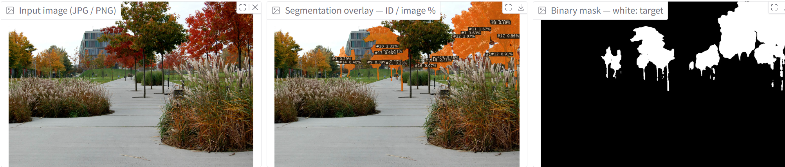
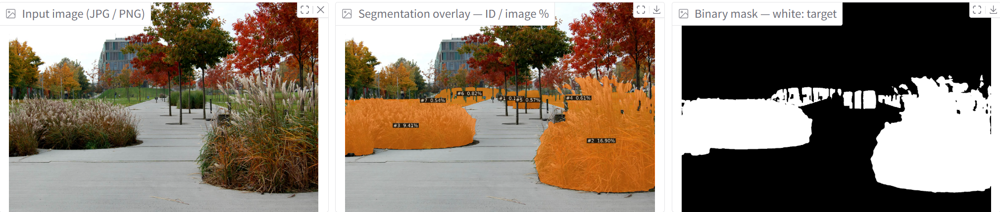

Photographs taken along a park route can help landscape architects document what visitors see. Image segmentation adds a quantitative layer to that record: it identifies regions in a photograph and allows us to calculate how much of the image they occupy. In this example, SAM 3 is used to explore concrete elements, trees, lawn, people, and more specific planting characteristics.

These measurements can support a park assessment, but they describe the visible composition of sampled views. They do not, on their own, establish a park's ecological performance, accessibility, safety, or overall quality.

## From mapped surfaces to visible landscapes

Satellite and aerial imagery can describe land cover from above. Airborne LiDAR can also provide three-dimensional information about terrain and vegetation. Photographs taken near pedestrian eye level provide a different perspective: the landscape visible from a particular position and direction. These sources answer different questions and can be used together.

Semantic segmentation assigns category labels to image pixels. Its use in measuring visible greenery predates SAM 3; for example, [Kameoka and colleagues (2022)](https://pmc.ncbi.nlm.nih.gov/articles/PMC8987839/) used image segmentation to calculate a Green View Index from street-view imagery. Conventional urban-scene datasets also cover multiple categories, including vegetation, buildings, roads, and people, as the [Cityscapes class definitions](https://www.cityscapes-dataset.com/dataset-overview/#class-definitions) demonstrate. Their limitation is often a predefined label set, rather than an inability to analyze multiple landscape elements.

SAM 3 offers a more flexible way to specify targets. It supports segmentation prompted by text or visual examples, rather than requiring every target to belong to a fixed list of classes. Its [research paper](https://arxiv.org/abs/2511.16719) describes this task as promptable concept segmentation. For landscape work, that flexibility makes it possible to test concepts beyond broad categories such as vegetation. It still requires checking whether the returned masks match the intended concept.

## A local SAM 3 example

The examples shown here were produced with a local SAM 3 application. The working environment was Ubuntu through Windows Subsystem for Linux, with an NVIDIA GeForce RTX 2080 used for GPU computation. This describes the example setup; it is not a guarantee that every SAM 3 configuration will run on the same hardware. For a new installation, consult the [official repository](https://github.com/facebookresearch/sam3#installation) for current software requirements and checkpoint access instructions.

Each screenshot shows the input photograph on the left, an orange segmentation overlay in the middle, and a binary mask on the right. White pixels in the binary mask represent the selected regions. The application's combined coverage is the share of image pixels included in the union of the returned masks for that run.

### Concrete elements

The prompt `concrete` selects portions of the pale constructed elements in the courtyard scene. The application reports combined coverage of 12.63% for this run. This is visible mask coverage, not a measurement of the site's total concrete area or its impervious surface ratio: vertical surfaces, perspective, and occlusion all affect the image, and appearance alone does not establish material permeability.



<p class="figure-caption">Figure 1. The concrete prompt produces candidate masks for visible constructed elements. The interface reports 12.63% combined image coverage and a displayed processing time of 3.7 seconds.</p>

### Trees and lawn

The `tree` prompt produces masks over several trees, but it also includes foreground planting that appears to be shrubs. The reported 30.04% coverage therefore should not be presented as validated tree coverage. This visible error is a useful reminder to inspect masks before turning them into design indicators.



<p class="figure-caption">Figure 2. The tree run reports 30.04% combined coverage. Foreground shrubs are also included, so the output requires correction before it can represent tree coverage.</p>

The lawn example highlights portions of the ground vegetation. A single instance label shows 16.50%, but the cropped screenshot does not show the prompt or a combined-coverage summary. That label should not be treated as a verified total for all lawn in the photograph.



<p class="figure-caption">Figure 3. The lawn example illustrates visible ground vegetation. The displayed 16.50% is an individual mask label, rather than a confirmed combined lawn total.</p>

### People in the view

The `human` prompt highlights people standing and sitting in the courtyard. The application reports 5.22% combined coverage and 57 masks. A mask count should not be reported as a verified visitor count: detections can be missed, duplicated, or fragmented. Likewise, visible pixel coverage varies with distance and occlusion, so it does not directly measure attendance or intensity of use.



<p class="figure-caption">Figure 4. The human run reports 5.22% combined coverage and a displayed processing time of 4.3 seconds. The 57 returned masks are not a validated count of people.</p>

## Testing more specific planting concepts

The second scene explores trees with different foliage colors and ornamental grass planting. The visible prompt `green tree` and the other illustrated results suggest how segmentation can be tested on more specific visual concepts. Color, lighting, mixed foliage, and overlapping plants make these distinctions uncertain; the masks need comparison with manually reviewed examples before quantitative comparisons are justified.



<p class="figure-caption">Figure 5. The green tree prompt is visible in this screenshot. Some selected foliage appears yellow or mixed in color, illustrating the need to check the intended color category.</p>



<p class="figure-caption">Figure 6. The red-foliage example highlights a different set of tree regions. The prompt and combined-coverage summary are not visible in this crop.</p>



<p class="figure-caption">Figure 7. The ornamental-grass example highlights planting beds beside the path. Segmentation of their appearance does not establish a botanical species identification.</p>

## What the pixel measurements mean

For a chosen concept, calculate image coverage as:

```text
Coverage (%) = pixels in the union of the concept's masks
               / total image pixels × 100
```

Using the union counts an overlapping pixel only once. Separate concept runs may also overlap, so their percentages should not automatically be added together. If categories must form a complete partition of the image, define how overlaps and unclassified pixels will be handled.

A Green View Index requires a clear definition of the vegetation included. A tree-only mask excludes lawn, shrubs, and other vegetation; it is not automatically an overall greenery index. Similarly, the share of visible built elements is a compositional measure, not a complete measure of spatial enclosure. Define and validate any enclosure indicator separately.

The interface displays 3.7 seconds for the concrete run, 2.2 seconds for the tree run, and 4.3 seconds for the human run. These are individual application readings, not a reproducible performance benchmark or a guarantee that a complete workflow takes less than ten seconds. Comparisons require consistent image resolution, model version, hardware, and timing boundaries, including whether loading and export are counted.

## A repeatable park survey workflow

To apply this approach across a park, start with a sampling plan that can be repeated:

1. **Define the question and the route.** Decide whether the survey concerns visible vegetation, built elements, planting character, or another clearly defined feature. Record locations and use a consistent sampling interval. Intervals such as 8 or 20 feet, approximately 2.4 or 6.1 meters, are possible pilot choices rather than established standards; select spacing for the site and the question.
2. **Keep photography consistent.** Use comparable camera height, image resolution, field of view, and pitch. Four headings separated by 90 degrees provide four directional samples at each point. They do not guarantee continuous panoramic coverage unless the camera's field of view is sufficient. Record season and lighting conditions, especially when studying foliage color.
3. **Fix the segmentation settings.** Record the exact prompt, model checkpoint, software version, and match-score threshold. The screenshots show thresholds of 0.30 for several courtyard runs and 0.25 for the green-tree run. Keep settings consistent for comparisons and document changes.
4. **Validate a representative subset.** Review masks against the photographs and compare them with manually labeled regions before accepting the measurements. Include difficult examples with shadows, overlapping vegetation, and distant objects. Correct visible errors or report their likely effect.
5. **Summarize with the sampling structure intact.** Retain image IDs, locations, headings, masks, and coverage values. If using a simple average, give each selected view the intended weight, then summarize by location or route segment. Avoid allowing points with more photographs to dominate accidentally.

Camera settings can change the measured greenery proportion, as [Xu and Niu (2024)](https://isprs-archives.copernicus.org/articles/XLVIII-4-2024/517/2024/) demonstrate. Consistent capture and validation are therefore part of the measurement method, rather than optional refinements.

The resulting dataset can support comparisons of sampled park views and identify places for closer field inspection. Combine it with site observations and other relevant measures when assessing park quality. The value of SAM 3 here is a flexible way to propose and measure visible regions, with the landscape architect responsible for defining the indicator and checking the evidence.
