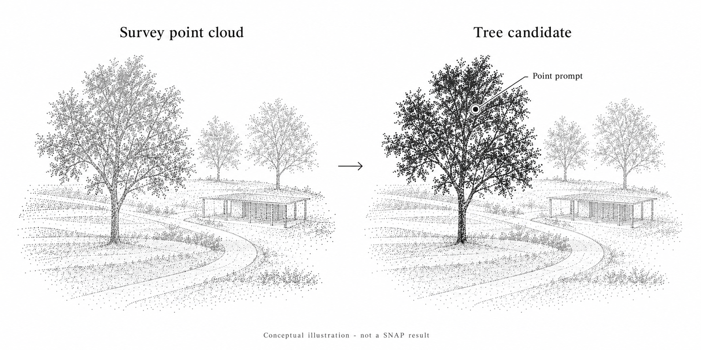
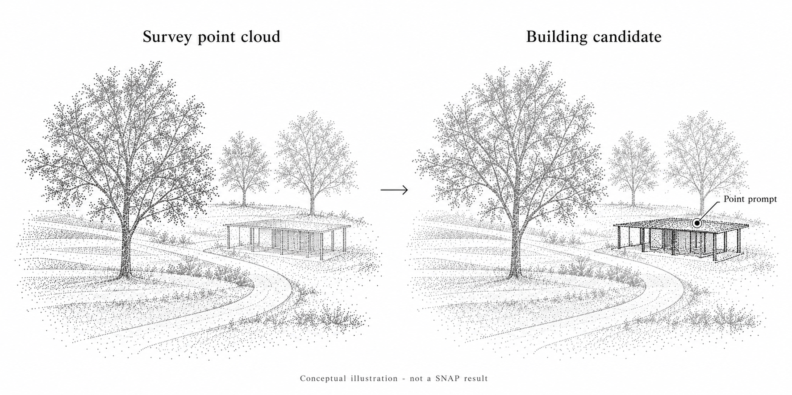
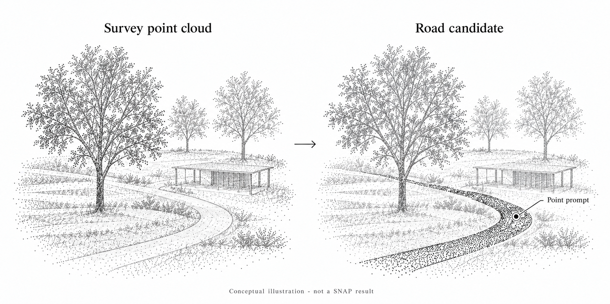

SNAP is an interactive point cloud segmentation model. Users can select an object with point prompts and refine its candidate segmentation. It also supports a text-based segmentation pipeline and was developed for indoor, outdoor, and aerial point clouds. [SNAP project](https://neu-vi.github.io/SNAP/)

For a landscape site survey, its potential value is helping designers turn complex three-dimensional data into a reviewed inventory of site features. The applications below describe a proposed workflow rather than a completed field test. All three illustrations are AI-generated conceptual examples, not actual SNAP outputs.

## Build a vegetation inventory

A useful starting task is to select individual trees or vegetation groups that need further investigation.

Figure 1. A point prompt identifies a candidate tree region for review. Conceptual illustration, not an actual SNAP result.

After reviewing a candidate segmentation, assign it an inventory ID and connect it to field photographs and observation notes. This creates a spatial reference for questions such as:

- Which canopy belongs to the tree being documented?
- How does that vegetation relate to a nearby path or structure?
- Which overlapping crowns need closer inspection on site?

Where the survey captures sufficient detail, reviewed selections could support subsequent estimates of canopy extent or tree height. These measurements require separate methods: height needs an appropriate ground reference, while canopy footprint needs a defined boundary calculation.

Species, tree condition, and retention recommendations still require field assessment. A geometric selection should not be treated as an arboricultural diagnosis.

## Document buildings and landscape edges

Another proposed application is selecting built features such as pavilions, retaining walls, or stair sequences for closer examination.

Figure 2. The pavilion's sampled surfaces are highlighted as a building candidate. This illustrates a proposed selection for review, not measured building geometry or an actual SNAP output.

Separating a feature from the surrounding point cloud could make its relationship to vegetation and circulation easier to inspect. A designer could review a wall in section, examine a level change beside a route, or connect a field photograph to a specific location in the three-dimensional survey.

This approach is most useful when the feature is sufficiently represented in the scan. Small edges or partially hidden surfaces may remain difficult to distinguish. Dimensions used for design decisions should be checked against the survey's accuracy and completeness.

## Examine roads and pedestrian routes

A road or path selection could help organize observations along an existing circulation route. After checking the candidate boundary, connect it to notes about adjacent planting, entrances, level changes, and places where additional measurements are needed.

Figure 3. Sampled points on the curving paved route are highlighted for review. Conceptual illustration, not proof of road-segmentation accuracy or an actual SNAP result.

The selection could provide a reference for inspecting route width or slope using separate measurement methods and suitable survey data. It does not establish pavement permeability, drainage performance, or accessibility compliance. Those questions require additional evidence and assessment.

## Use uncertain results to guide fieldwork

Segmentation can also help organize the next site visit.

A merged vegetation region, an unclear boundary, or a gap in the survey can become a specific field question. Record the location and uncertainty, then inspect it on site.

For example, a candidate tree region that overlaps a pavilion could prompt a check of canopy clearance and trunk location. A poorly captured wall or road edge could indicate where additional photographs or measurements are needed.

The aim is to connect digital observations with field evidence, including evidence that challenges the initial interpretation.

## A simple survey workflow

1. **Choose one inventory task.** Start with a representative area and a clear target, such as trees along a proposed route.
2. **Prepare the point cloud.** Retain the original data, coordinate reference, units, and acquisition date.
3. **Select and review features.** Add point prompts, inspect the masks from several viewpoints, and refine uncertain selections. The official demonstration supports multiple points on an object before finalizing its segmentation. [Interactive demo](https://github.com/neu-vi/SNAP#interactive-demo)
4. **Connect accepted selections to field records.** Keep object IDs, locations, photographs, and unresolved questions together.

Evaluate the pilot by how much correction it requires and whether its reviewed selections help answer the survey question. Benchmark results in the SNAP paper do not establish accuracy for a particular landscape project. [Research paper](https://arxiv.org/html/2510.11565v2)

SNAP could provide a practical bridge between point cloud data and a landscape site inventory. The designer remains responsible for checking the selections, investigating missing information, and deciding which observations matter for the project.
